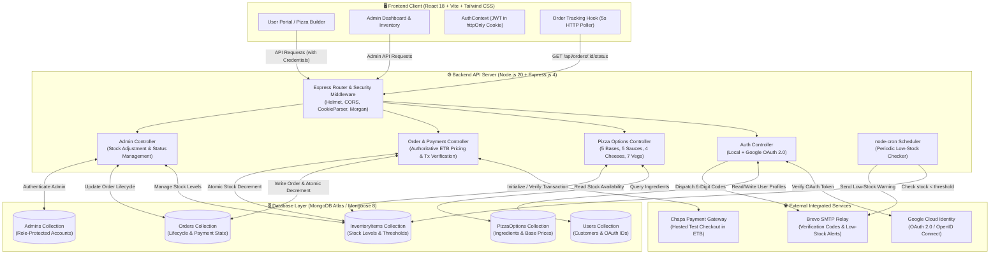
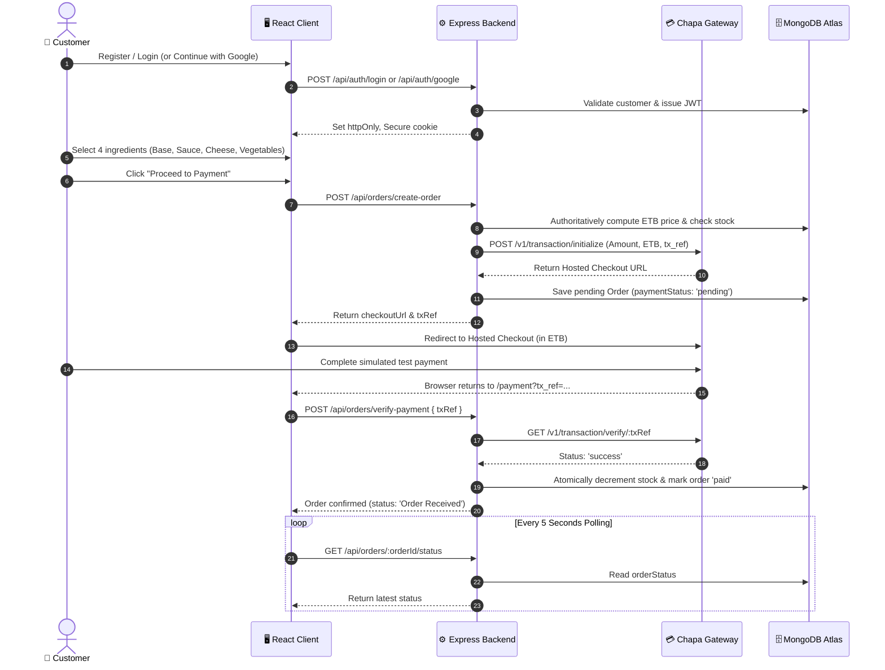

# 🍕 Pizza Delivery Full-Stack Application

<p align="center">
  
  
  
  
</p>

<p align="center">
  
  
  
  
  
  
</p>

> **Oasis Infobyte Student Internship Program (OIB-SIP)**  
> **Track:** Web Development and Designing  
> **Level:** Level 3 — Task 1: Pizza Delivery Application  
> **Architecture:** Decoupled Monorepo (React Client + Node.js/Express Server + MongoDB Atlas)

---

## 📌 Executive Overview

The **Pizza Delivery Full-Stack Application** is a production-grade web application engineered to fulfill all Level 3 Task 1 requirements specified by the Oasis Infobyte internship program.

The application delivers an end-to-end e-commerce experience:
1. **Customer Journey:** Account registration with email verification code, Google OAuth 2.0 / OpenID Connect single sign-on, secure cookie-based JWT authentication, interactive 4-step custom pizza builder, server-authoritative dynamic pricing in Ethiopian Birr (ETB), Chapa test-mode payment gateway integration, order confirmation, and real-time order status tracking with a 3-stage visual progress stepper.
2. **Administrative Control:** Dedicated isolated login, real-time inventory management with low-stock badges, manual stock adjustments, order management with immediate order lifecycle updates (`Order Received` → `In Kitchen` → `Sent to Delivery`), and an automated `node-cron` low-stock email alert system.

---

## 🏗️ System Architecture & Data Flow



---

## 🔄 End-to-End User Journeys

### 1. Customer Customization, Payment & Tracking Flow



### 2. 3-Stage Visual Order Stepper Progression

```
[ Step 1: Order Received ] ────────► [ Step 2: In Kitchen ] ────────► [ Step 3: Sent to Delivery ]
          🟢                                   🟡                                   🔵
    Payment confirmed                  Ingredients assembled                Dispatched with courier
  Stock atomically reserved              Baking in wood oven                  Real-time 5s polling
```

---

## 🚀 Key Features

### Customer Experience (User Portal)
- **Authentication & Security:**
  - Secure customer registration with Brevo 6-digit email verification code.
  - "Continue with Google" OAuth 2.0 / OpenID Connect single sign-on (customer-only, safe account linking).
  - JWT issued in an `httpOnly`, `SameSite=Strict` cookie (impervious to XSS theft).
  - Forgot-password flow with time-limited reset tokens (1-hour expiry).
  - Route guards on client and server ensuring only verified customers place orders.
- **Pizza Menu & Interactive Builder:**
  - Dynamic catalogue displaying 5 crust bases, 5 sauces, 4 cheeses, and 7 vegetable toppings.
  - Guided 4-step customization wizard:
    - **Step 1:** Crust Base (required single-select).
    - **Step 2:** Sauce (required single-select).
    - **Step 3:** Cheese (required single-select).
    - **Step 4:** Vegetables (optional multi-select with zero-to-many options).
  - Live client price preview in Ethiopian Birr (ETB), backed by server-authoritative price calculation from MongoDB base prices.
- **Checkout & Payment (Chapa Test Mode):**
  - Order review screen displaying ingredient breakdown and total amount in Ethiopian Birr (ETB).
  - Seamless Chapa hosted checkout redirect integration.
  - Server-side authoritative verification with Chapa API (`POST /v1/transaction/initialize` and `GET /v1/transaction/verify/:txRef`) before order confirmation.
  - Double-confirmation idempotency guards against network retries and duplicate webhooks.
  - Atomic inventory decrement upon successful payment confirmation.
- **Order Lifecycle & Tracking:**
  - Dedicated "My Orders" customer portal displaying full chronological order history with ETB totals.
  - Live order tracking page with 5-second HTTP polling that auto-stops upon reaching the final state.
  - 3-stage visual stepper: `Order Received` ➔ `In Kitchen` ➔ `Sent to Delivery`.

### Administrator Experience (Admin Portal)
- **Isolated Access:**
  - Dedicated unlinked `/admin/login` page (isolated from customer navigation).
  - Credentials seeded directly into the database; no public admin registration endpoint.
  - Strict role authorization (`requireAdmin` middleware returning HTTP 403 on customer tokens).
- **Inventory Oversight & Control:**
  - Live inventory table showing current stock, unit measurements, and threshold limits.
  - Inline manual stock updates with instant validation (rejects negative numbers).
  - Real-time low-stock visual badges and watchlist alerts when `currentStock < lowStockThreshold`.
- **Order Management:**
  - Order dashboard listing all customer orders sorted newest first.
  - In-place lifecycle transition dropdown (`Order Received` ➔ `In Kitchen` ➔ `Sent to Delivery`).
  - Status updates propagate to customer polling endpoints in $\le$ 5 seconds.
  - Sensitive internal payment signatures strictly omitted from API output.
- **Automated Low-Stock Alert Cron:**
  - Configurable `node-cron` job (`CRON_SCHEDULE`, default: every 30 minutes).
  - Automatically queries inventory items where `currentStock < lowStockThreshold`.
  - Dispatches aggregated HTML & plaintext warning emails to the administrator.

---

## 🛠️ Technology Stack

| Layer | Technologies & Libraries | Purpose & Implementation |
| :--- | :--- | :--- |
| **Frontend (Client)** | React 18, Vite 5, React Router v6, Tailwind CSS 3, Axios | High-performance reactive UI with component modularity and responsive styling |
| **Backend (Server)** | Node.js 20 LTS, Express.js 4, Mongoose 8, MongoDB (Atlas / Memory Server) | RESTful API backend with Mongoose ODM modeling and atomic transactional operations |
| **Security & Auth** | JSON Web Tokens (`jsonwebtoken`), Google OAuth 2.0 (`google-auth-library`), `bcryptjs`, `cookie-parser`, `helmet`, `cors` | Zero-trust authentication with `httpOnly` secure cookies and role-based route guards |
| **Payments** | Chapa API v1 (Test Mode), Ethiopian Birr (ETB), unique `txRef`, HMAC Webhook | Authoritative payment gateway with server verification and ETB currency localization |
| **Email & Scheduling** | `nodemailer` (Brevo SMTP relay), `node-cron` | Asynchronous transactional notification pipeline and background inventory monitors |
| **Testing & Quality** | Jest, Supertest, MongoDB Memory Server, ESLint (Airbnb-base), Prettier | 100% offline regression harness and strict code quality enforcement |

---

## 📂 Project Architecture

```
Pizza Delivery/
├── client/                              # Frontend React application (Vite)
│   ├── public/
│   │   ├── _redirects                   # SPA routing fallback for Netlify/Render
│   │   └── favicon.svg                  # Brand favicon
│   ├── src/
│   │   ├── api/                         # Axios API clients (auth, pizza, order, admin)
│   │   ├── components/
│   │   │   ├── builder/                 # StepBase, StepSauce, StepCheese, StepVegetables
│   │   │   ├── common/                  # Navbar, ProtectedRoute, UI primitives
│   │   │   └── orders/                  # OrderStatusProgress stepper, OrderCard
│   │   ├── context/                     # AuthContext, OrderContext
│   │   ├── hooks/                       # useAuth, useOrderStatus (polling)
│   │   ├── pages/                       # Login, Register, VerifyEmail, Dashboard,
│   │   │                                # PizzaBuilder, OrderSummary, OrderStatus, MyOrders
│   │   └── pages/admin/                 # AdminLogin, AdminDashboard, AdminInventory, AdminOrders
│   ├── .env.example
│   ├── package.json
│   ├── tailwind.config.js
│   ├── vercel.json                      # SPA routing fallback for Vercel
│   └── vite.config.ts
├── server/                              # Backend Express application
│   ├── src/
│   │   ├── config/                      # db.js (Atlas DNS SRV resilience), constants.js
│   │   ├── controllers/                 # auth, pizzaOptions, order, admin
│   │   ├── jobs/                        # lowStockCheck.js (node-cron job)
│   │   ├── middleware/                  # auth.middleware, role.middleware, errorHandler
│   │   ├── models/                      # User, Admin, PizzaOption, InventoryItem, Order
│   │   ├── routes/                      # auth, pizzaOptions, order, admin
│   │   ├── scripts/                     # seedAdmin.js, seedPizzaOptions.js
│   │   ├── services/                    # email.service, payment.service, inventory.service, googleAuth.service
│   │   └── utils/                       # apiResponse, generateToken, jwt
│   ├── tests/                           # 7 Jest test suites (132 automated tests)
│   │   ├── auth.test.js
│   │   ├── googleAuth.test.js
│   │   ├── pizzaOptions.test.js
│   │   ├── orders.test.js
│   │   ├── orderTracking.test.js
│   │   ├── admin.test.js
│   │   └── lowStockCron.test.js
│   ├── .env.example
│   ├── server.js
│   └── package.json
├── scripts/
│   └── dev.js                           # Concurrent full-stack dev runner with conflict detection
├── package.json                         # Monorepo root workspace orchestrator
├── project_plan.md                      # Authoritative blueprint (Revision 3 APPROVED)
├── project_progress.md                  # Milestone & requirements tracker
└── README.md                            # Comprehensive project documentation
```

---

## ⚙️ Environment Configuration

### Server (`server/.env`)
Create a `.env` file in the `server/` directory modeled after [`server/.env.example`](file:///c:/Users/hp/Desktop/folders/OASIS%20Infobyte/Pizza%20Delivery/server/.env.example):

```dotenv
NODE_ENV=development
PORT=5000
MONGO_URI=mongodb+srv://<username>:<password>@cluster0.zhbtswy.mongodb.net/pizza-delivery?retryWrites=true&w=majority
CLIENT_ORIGIN=http://localhost:5173

# Auth / JWT
JWT_SECRET=super_secret_jwt_key_at_least_32_characters_long
JWT_EXPIRY=7d

# Google OAuth 2.0 (Customer-Only)
GOOGLE_CLIENT_ID=your_google_client_id_placeholder.apps.googleusercontent.com
GOOGLE_CLIENT_SECRET=your_google_client_secret_placeholder
GOOGLE_CALLBACK_URL=http://localhost:5001/api/auth/google/callback

# Payment Gateway (Chapa Test Mode)
CHAPA_SECRET_KEY=CHASECK_TEST-your_chapa_test_secret_key_placeholder
# Note: Chapa requires HTTPS for callback/return URLs. In local dev, leave commented out:
# CHAPA_CALLBACK_URL=https://your-domain.com/api/orders/chapa/webhook
# CHAPA_RETURN_URL=https://your-domain.com/payment

# Email & Automated Alerts (Brevo SMTP)
EMAIL_HOST=smtp-relay.brevo.com
EMAIL_PORT=587
EMAIL_USER=your_brevo_smtp_user
EMAIL_PASS=your_brevo_smtp_pass
EMAIL_FROM=orders@yourverifieddomain.com
ADMIN_ALERT_EMAIL=admin@example.com

# Cron Inventory Check
CRON_SCHEDULE=*/30 * * * *
LOW_STOCK_THRESHOLD=20
```

### Client (`client/.env`)
Create a `.env` file in the `client/` directory modeled after [`client/.env.example`](file:///c:/Users/hp/Desktop/folders/OASIS%20Infobyte/Pizza%20Delivery/client/.env.example):

```dotenv
VITE_API_BASE_URL=/api
VITE_GOOGLE_CLIENT_ID=your_google_client_id_placeholder.apps.googleusercontent.com
```

---

## 📦 Step-by-Step Installation & Setup

### 1. Prerequisites
- **Node.js:** v20.x or v22+
- **npm:** v10+
- **MongoDB:** Local MongoDB replica set or MongoDB Atlas cluster

---

### ⚡ Quick Start: One Command for Both Server & Client (Recommended)

You can launch the complete full-stack application with a single command from the root directory:

```bash
# 1. Install dependencies for both server and client in one step
npm run install:all

# 2. Start local MongoDB (if needed), Express Backend (port 5001), and Vite Frontend (port 5173) concurrently
npm run dev
```

Once running:
- **Frontend App:** [http://localhost:5173](http://localhost:5173)
- **Backend API:** [http://localhost:5001](http://localhost:5001)
- Press `Ctrl+C` to cleanly stop all services.

---

### 🛠️ Manual / Individual Component Setup

If you prefer to run services in separate terminals:

#### Backend Setup
```bash
# Navigate to server directory
cd server

# Install dependencies
npm install

# Seed default administrator account (admin@pizzaapp.dev)
npm run seed:admin

# Seed authentic pizza ingredient catalogue and inventory items
npm run seed:options

# Start development server
npm run dev
# Server will listen on http://localhost:5001
```

#### Frontend Setup
```bash
# In a separate terminal, navigate to client directory
cd client

# Install dependencies
npm install

# Start Vite development server
npm run dev
# Client will be accessible at http://localhost:5173
```

---

## 🧪 Automated Testing & Verification

The backend includes a comprehensive automated test suite powered by **Jest**, **Supertest**, and an in-memory database (**MongoDB Memory Server**). The tests run completely offline without external network dependencies.

```bash
cd server

# Run full regression test suite (132 tests across 7 suites)
npm test

# Run code style & linting audit (Airbnb Base ESLint)
npm run lint
```

```bash
cd client

# Verify production bundle build
npm run build
```

### Test Coverage Breakdown

```
Test Suites: 7 passed, 7 total
Tests:       132 passed, 132 total
Snapshots:   0 total
Time:        100% PASS
```

- `tests/auth.test.js` (31 tests): Registration, duplicate rejection, Brevo email verification code, password hashing, JWT cookies, protected route authentication, forgot-password, reset tokens.
- `tests/googleAuth.test.js` (11 tests): Customer-only Google OAuth 2.0 flow, verified Google email, safe deterministic account linking (preserves password), admin privilege protection, session cookie issuance.
- `tests/pizzaOptions.test.js` (16 tests): PizzaOption & InventoryItem schemas, compound indexes, idempotent seed scripts, category filtering APIs.
- `tests/orders.test.js` (27 tests): Authoritative ETB pricing calculation, inventory pre-checks, Chapa transaction initialization, server-side transaction verification (`/verify/:txRef`), atomic inventory decrement, double-confirmation idempotency, degraded fallback.
- `tests/orderTracking.test.js` (13 tests): Order history isolation, descending timestamp sorting, polling endpoint, ownership authorization, 3-stage lifecycle progression, sensitive payment signature omission.
- `tests/admin.test.js` (21 tests): Admin access guards, customer JWT rejection (403), inventory retrieval, manual stock updates, negative stock rejection, order listing, status lifecycle updates, live customer polling propagation.
- `tests/lowStockCron.test.js` (12 tests): Strict threshold detection (`<`), custom threshold evaluation, aggregated alert email dispatch, error safety, scheduler singleton registration.

---

## 🔐 Default Seed Credentials

For evaluation and demonstration purposes, default accounts can be seeded via the included scripts:

| Role | Portal URL | Seed Email | Seed Password | Permissions |
| :--- | :--- | :--- | :--- | :--- |
| **Admin** | `/admin/login` | `admin@pizzaapp.dev` | `Admin@123456` | Full inventory & order management |
| **Customer** | `/login` | Register via `/register` | User choice | Pizza builder, checkout, order tracking |

> [!NOTE]
> The seeded admin account (`admin@pizzaapp.dev` / `Admin@123456`) is exclusively for local demonstration and automated testing evaluation. It is created idempotently by `scripts/seedAdmin.js`. In any production deployment, administrators should configure custom credentials using `ADMIN_EMAIL` and `ADMIN_PASSWORD` in the server environment.

---

## 📋 Oasis Infobyte Task Compliance Matrix

| FR ID | Feature Description | Implementation Location | Verification Method | Status |
| :--- | :--- | :--- | :--- | :--- |
| **FR-U01** | User Registration | `server/src/controllers/auth.controller.js` | Automated Integration Test (`auth.test.js`) | ✅ Satisfied |
| **FR-U02** | Email Verification Dispatch | `server/src/controllers/auth.controller.js` | Unit/Mock Test (`auth.test.js`) | ✅ Satisfied *(Live external delivery PENDING [E])* |
| **FR-U03** | httpOnly Cookie JWT Login | `server/src/utils/jwt.js` | Automated Integration Test (`auth.test.js`) | ✅ Satisfied |
| **FR-U04** | Cookie-Based Authentication | `server/src/middleware/auth.middleware.js` | Automated Integration Test (`auth.test.js`) | ✅ Satisfied |
| **FR-U05** | Forgot-Password Flow | `server/src/controllers/auth.controller.js` | Unit/Mock Test (`auth.test.js`) | ✅ Satisfied *(Live external delivery PENDING [E])* |
| **FR-U06** | Password Reset Flow | `server/src/controllers/auth.controller.js` | Automated Integration Test (`auth.test.js`) | ✅ Satisfied |
| **FR-U07** | Customer Dashboard & Catalogue | `client/src/pages/Dashboard.jsx` | Integration Test & UI Audit | ✅ Satisfied |
| **FR-U08** | Custom Pizza Builder Entry | `client/src/pages/PizzaBuilder.jsx` | UI Audit & Route Guard Verification | ✅ Satisfied |
| **FR-U09** | Step 1: Base Selection (5 choices) | `client/src/components/builder/StepBase.jsx` | Automated Test (`pizzaOptions.test.js`) | ✅ Satisfied |
| **FR-U10** | Step 2: Sauce Selection (5 choices)| `client/src/components/builder/StepSauce.jsx` | Automated Test (`pizzaOptions.test.js`) | ✅ Satisfied |
| **FR-U11** | Step 3: Cheese Selection | `client/src/components/builder/StepCheese.jsx` | Automated Test (`pizzaOptions.test.js`) | ✅ Satisfied |
| **FR-U12** | Step 4: Vegetable Selection (Optional)| `client/src/components/builder/StepVegetables.jsx`| Automated Test (`orders.test.js`) | ✅ Satisfied |
| **FR-U13** | Server-Authoritative Order Summary | `server/src/controllers/order.controller.js` | Automated Integration Test (`orders.test.js`) | ✅ Satisfied |
| **FR-U14** | Chapa Test-Mode Checkout | `server/src/services/payment.service.js` | Integration Test (`orders.test.js`) | ✅ Satisfied |
| **FR-U15** | Server-Side Chapa Verification | `server/src/controllers/order.controller.js` | Automated Integration Test (`orders.test.js`) | ✅ Satisfied |
| **FR-U16** | 5s Order Status Polling Tracker | `client/src/hooks/useOrderStatus.js` | Automated Test (`orderTracking.test.js`) | ✅ Satisfied |
| **FR-A01** | Separate Admin Login Page | `client/src/pages/admin/AdminLogin.jsx` | Isolated Route Audit & Role Guard | ✅ Satisfied |
| **FR-A02** | Seeded Admin Credentials | `server/src/scripts/seedAdmin.js` | Automated Test (`pizzaOptions.test.js`) | ✅ Satisfied |
| **FR-A03** | Admin Inventory Dashboard | `client/src/pages/admin/AdminInventory.jsx` | Automated Integration Test (`admin.test.js`) | ✅ Satisfied |
| **FR-A04** | Atomic Inventory Decrement | `server/src/services/inventory.service.js` | Automated Integration Test (`orders.test.js`) | ✅ Satisfied |
| **FR-A05** | Manual Stock Update by Admin | `server/src/controllers/admin.controller.js` | Automated Integration Test (`admin.test.js`) | ✅ Satisfied |
| **FR-A06** | Automated Low-Stock Cron Email | `server/src/jobs/lowStockCheck.js` | Automated Integration Test (`lowStockCron.test.js`)| ✅ Satisfied *(Live external delivery PENDING [E])* |
| **FR-A07** | Admin Orders Overview | `client/src/pages/admin/AdminOrders.jsx` | Automated Integration Test (`admin.test.js`) | ✅ Satisfied |
| **FR-A08** | Order Lifecycle Status Updates | `server/src/controllers/admin.controller.js` | Automated Integration Test (`admin.test.js`) | ✅ Satisfied |
| **FR-A09** | Immediate Status Propagation | `server/tests/admin.test.js` | Automated Integration Test (`admin.test.js`) | ✅ Satisfied |


## 📄 License & Attribution

Developed as an official Level 3 submission for the **Oasis Infobyte Student Internship Program (OIB-SIP)** in Web Development & Designing.  
All rights reserved © 2026.
